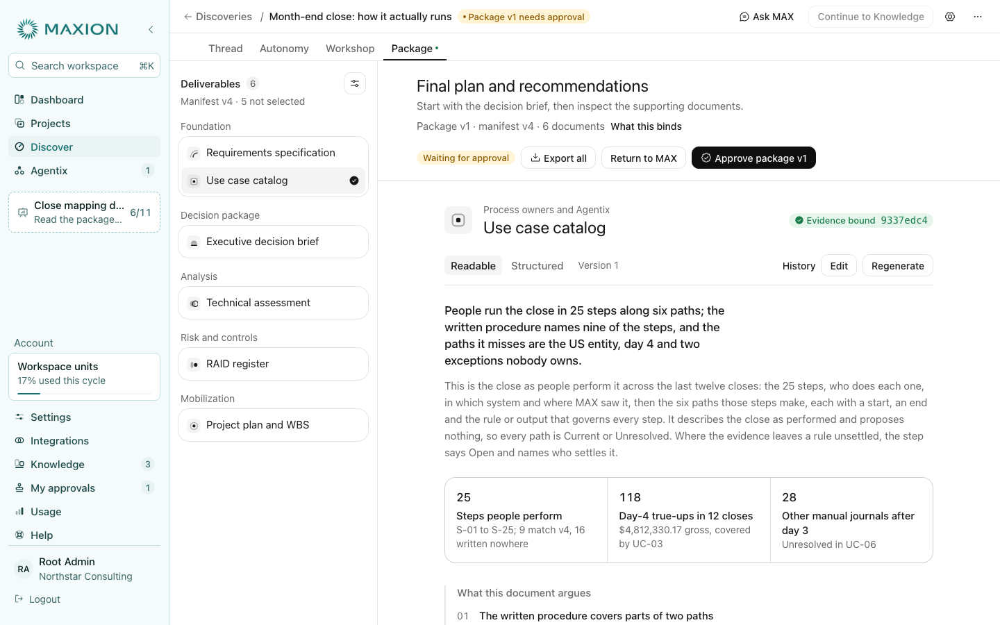
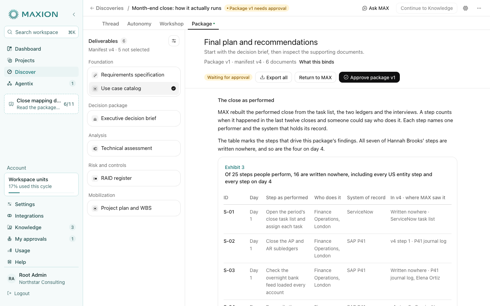
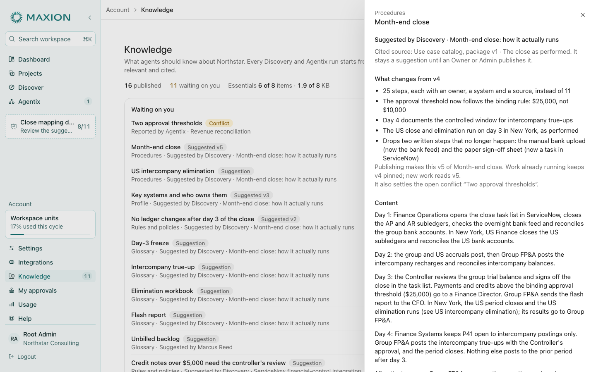

# Close-mapping demo: Discovery to Knowledge

**Date:** 2026-11-05. **Source plan:** `maxion-agent-platform` docs 05 (Discovery behavior, D-043, D-044, D-122) and 22 (Organization knowledge, D-088).

A fifth customer demo, and the first that builds nothing. Northstar's Controller asks MAXION to map how the month-end close actually runs. Discovery reads four sources, interviews four people and stops at one decision. The approved package then goes to **Knowledge** as eight suggestions, and the Controller publishes them one at a time. The runbook is [docs/demo-knowledge-mapping.md](../../demo-knowledge-mapping.md). Everything is simulated in the browser.

The build began in another session's worktree (`claude/close-map-demo-20261102`) and was never committed there. This change brings it onto `main`, which by then included the plan-gap release, and corrects how the package relates to the plan's deliverables.

## What the demo adds

- **A second ending for the demo harness.** A script ends in `agentix` (the four existing demos, 14 beats) or `knowledge` (this one, 11 beats). Both share the seven Discovery beats. The presenter dock, the guide and the progress reader read the beats from the script.
- **Packages that go to Knowledge.** A scenario can hand its package to Knowledge instead of Agentix. Approving the package still publishes nothing. **Continue to Knowledge** sends one immutable packet, and its findings arrive as suggestions an Owner or Admin approves one by one (D-088). A package going to Knowledge needs none of the three documents Agentix requires; it requires the documents its suggestions cite instead (`KNOWLEDGE_CITED_DOCUMENTS`).
- **Suggested next versions in Knowledge.** A suggestion can revise a published item. Its sheet shows what changes, says work already running keeps the old version pinned, names the conflict it settles, and publishes within the essentials budget. Approvals and rejections are recorded.
- **A per-demo Knowledge library.** In a demo the library is saved under the demo's own key, so a reload keeps what was approved and the everyday library is never touched. Each new close-mapping Discovery starts the library again from its seed.

## How the package relates to the deliverables

The Knowledge items aren't deliverables. The deliverables are the package's documents. Knowledge receives suggestions drawn from the version the Controller approved, and each one cites where in that version it came from.

| Before (the uncommitted build) | The plan says | Now |
| --- | --- | --- |
| Selected the Executive decision brief, As-Is / To-Be process analysis, Technical assessment, RAID register and Use case catalog | The first release ships the Technical assessment, Use case catalog, Requirements specification, Project plan and WBS, and RAID log (D-122) | Those five, plus the Executive decision brief every customer demo tells its story from |
| Kept the 25-step process map in the As-Is / To-Be analysis, in a mission with no to-be | The Use case catalog holds the process specification and maps: current process, stable step IDs, accountable actors, decisions (D-044) | The Use case catalog holds the steps as written and as performed (S-01 to S-25), who performs them, the timeline, the six paths and the close's glossary. The As-Is document isn't selected and points at the catalog |
| Four of eight suggestions cited an interview or the Controller's decision directly | Discovery suggests additions to Knowledge from its approved work (D-088); approval binds one exact version (D-122) | Every suggestion cites one section of a selected document, with the package version the packet carries, for example "Use case catalog, package v1 · UC-02: US entity close and elimination, from Hannah Brooks' interview" |

| Knowledge suggestion | Cited section |
| --- | --- |
| Month-end close v5 | Use case catalog · The close as performed |
| US intercompany elimination (Finance only) | Use case catalog · UC-02: US entity close and elimination |
| Key systems and who owns them v3 | Technical assessment · Systems of record |
| No ledger changes after day 3 of the close v2 | RAID register · Decided in Discovery |
| Day-3 freeze, Intercompany true-up, Elimination workbook, Flash report | Use case catalog · Terms the close uses |

A glossary suggestion's meaning is the catalog's sentence, word for word, read from one constant. A unit test checks, on both decision paths, that every cited document is selected and every cited section exists in the version that path produces.

The package with its six documents, the Use case catalog open:

The steps as performed, S-01 to S-25, in the catalog:

The procedure's suggestion in Knowledge, citing the catalog section it came from:

## Found in review and fixed

An independent review of the change found six defects, each off the scripted path:

- **A suggested next version could promise one number and publish another.** If the procedure moved after the suggestions arrived (for example, the threshold conflict's own correction), the sheet still said v5 and publishing wrote v6. The badge, the sheet and the toast now read the number from the item as it is.
- **New items could reuse an id after a reload.** A demo's saved library outlived the id counter. New ids now skip every id already in the library.
- **A switched-off document was still cited.** For a package going to Knowledge, the documents its suggestions cite (Use case catalog, Technical assessment, RAID register) are now Required outputs. Switching one off is recorded as an exception, and the suggestions that cite it aren't sent.
- **Approving a suggestion whose original was withdrawn made a second item with the same name.** It now brings the original back as its next version.
- **Rejecting the procedure or the restricted suggestion left the presenter stuck.** A rejection now ends its beat, as either answer does at an Agentix demo's decision. The last beat says what was rejected and how to show it again.
- **A reload right after Continue to Knowledge could leave Knowledge empty.** The Knowledge beats now send the packet the record holds. Knowledge receives a packet once, so sending it again only opens the library.

## Also fixed

- **A document with three key figures showed an empty grey fourth cell.** The figure row was a fixed four-column grid, so every scenario's Use case catalog (three figures) showed the divider colour in the empty slot. The row now has one column per figure, and on a narrow pane an odd figure out spans the pair.

## Deliberately left

- **Knowledge learning by itself.** Approved findings becoming organization context automatically is deferred in the plan, so each item takes one approval.
- **The freeze as a binding rule.** It arrives as guidance, because a binding rule needs a platform control in P41.
- **The other four demos keep their 14 beats.** One thing changes for them: a demo's Knowledge library is now saved like its other modules, so a reload keeps what was approved there. A restart or a new tab clears it, as before.

## Numbers that are demo choices, not the plan's

All of Northstar's close figures: 25 steps, 118 day-4 true-ups worth $4,812,330.17, the 28 other journals, the $25,000 threshold date, and the people.
